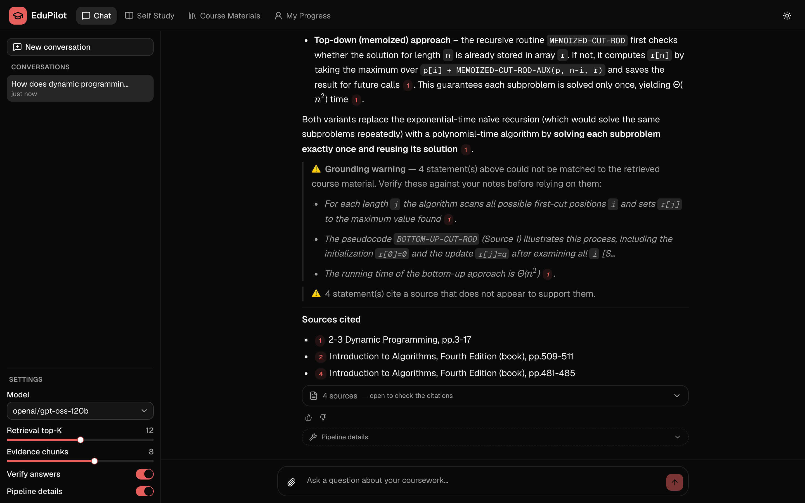
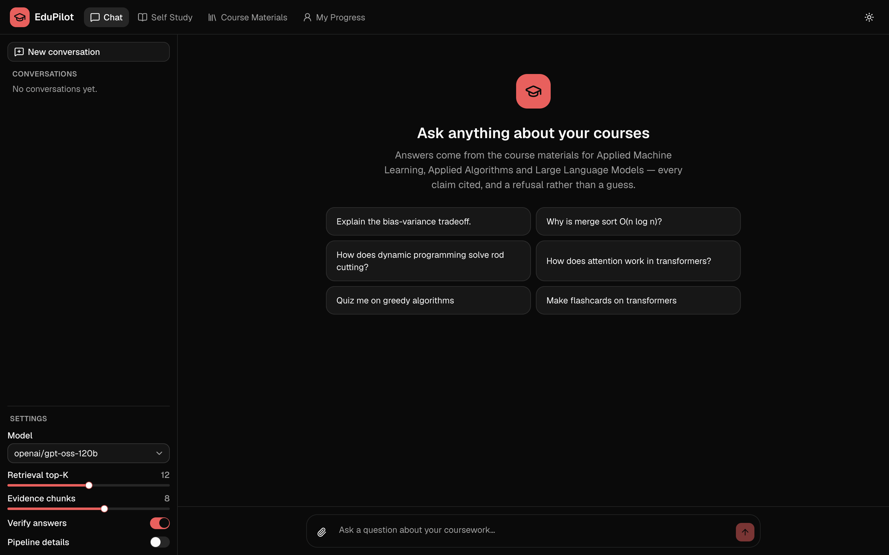
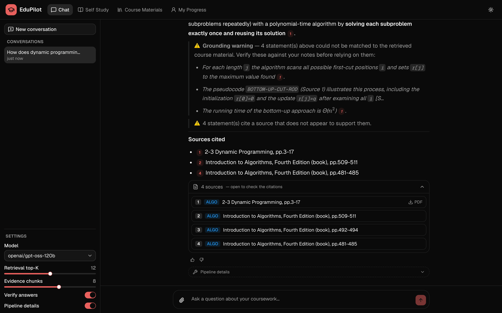
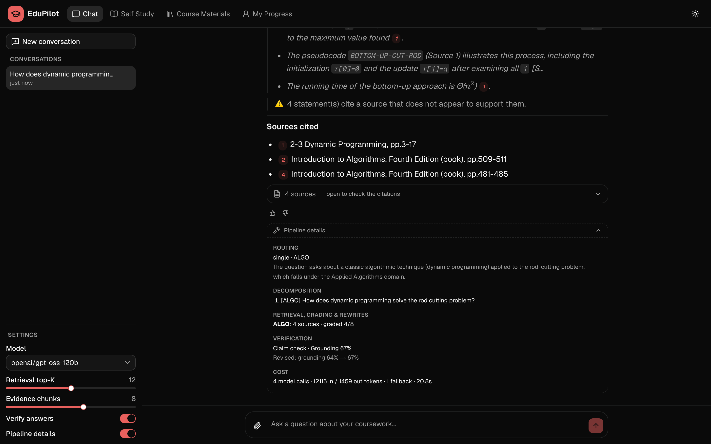
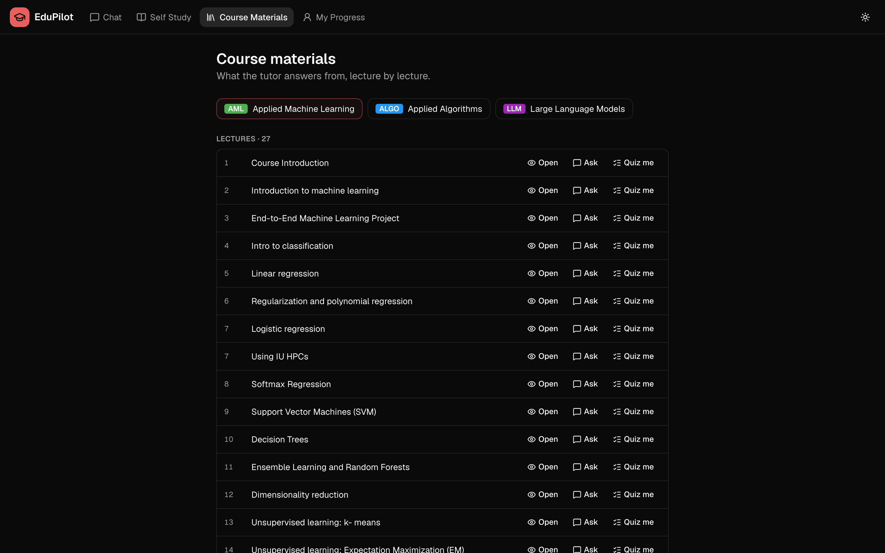
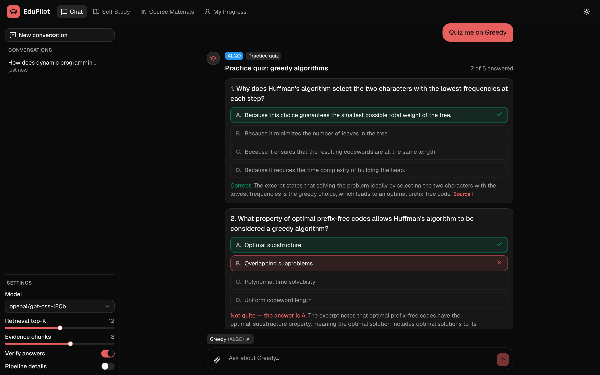
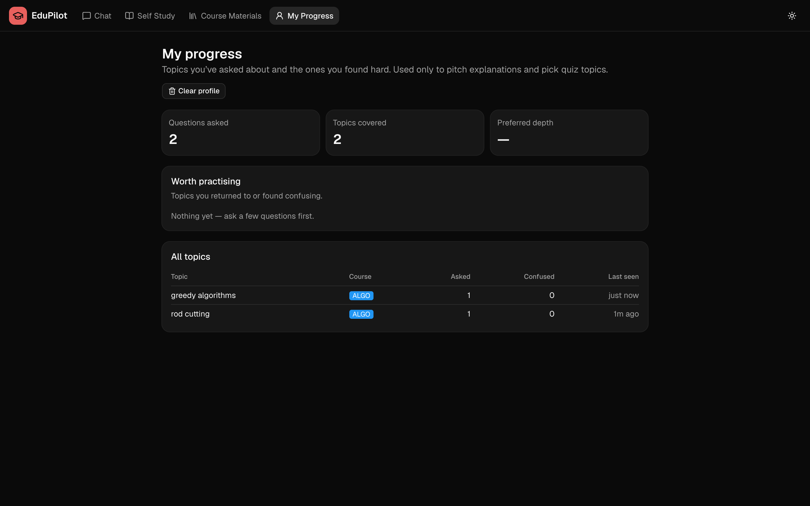
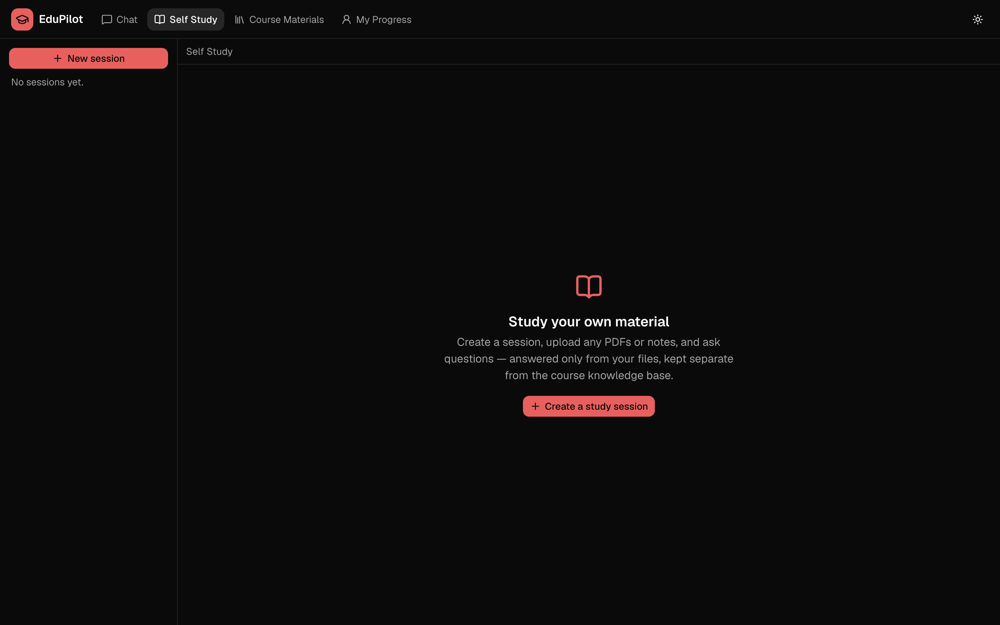
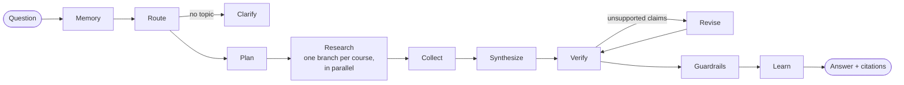
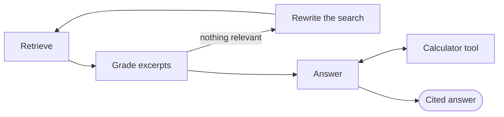

# EduPilot

**An AI tutor that answers from your course materials, cites the page it used, and says so when the material doesn't cover something.**

EduPilot answers questions for three Indiana University courses: Applied Machine Learning (AML), Applied Algorithms (ALGO) and Large Language Models (LLM). Every answer is built from the courses' own lecture slides, with each course's textbook as supporting material. Every claim carries a citation, and every answer is checked against its sources before the student sees it. Students can also take quizzes on any lecture, study their own uploaded notes, and see which topics they keep coming back to.



---

## Contents

- [What it does](#what-it-does)
- [Screenshots](#screenshots)
- [How an answer is made](#how-an-answer-is-made)
- [Retrieval](#retrieval)
- [Keeping answers honest](#keeping-answers-honest)
- [Speed and scale](#speed-and-scale)
- [What changed from the original version](#what-changed-from-the-original-version)
- [Tech stack](#tech-stack)
- [Project layout](#project-layout)
- [Getting started](#getting-started)
- [Configuration](#configuration)
- [Tests and CI](#tests-and-ci)
- [Authors](#authors)

---

## What it does

- **Chat with your courses.** Ask in your own words. The answer streams in as it's written, with numbered citations; click one to jump to its source, with the lecture and page, and open the slides from there.
- **Follow-ups work.** "Explain that in more detail" or "why?" is understood as being about the previous question, and is searched as the full question it refers to.
- **Lecture first, textbook for depth.** Answers lead with what your instructor's slides say and use the textbook to fill gaps, citing the book by page ("Introduction to Algorithms, Fourth Edition (book), pp.487-490").
- **Course Materials.** Every lecture of every course, in course order and under its real title. Open the slides, start a chat about one lecture, or ask for a quiz on it in one click.
- **Quizzes and flashcards.** "Quiz me on greedy algorithms" writes multiple-choice questions from the course material. Each question shows instant feedback and the source it was drawn from.
- **Self Study.** Upload your own PDFs or notes into a private session and ask questions answered only from those files.
- **My Progress.** The topics you've asked about and the ones you found confusing, which the tutor uses to pitch explanations and pick quiz topics.
- **Pipeline details.** An optional panel under each answer shows how it was made: routing, retrieval and grading, the verification score, model calls, tokens and time.

## Screenshots

All in dark mode.

| | |
|---|---|
|  |  |
| **Chat.** Ask anything about the three courses. | **Sources.** Lectures listed first, textbook pages after; statements the check couldn't match are flagged. |
|  |  |
| **Pipeline details.** Routing, retrieval and grading, the claim check, and the cost of one answer. | **Course Materials.** Each lecture with Open, Ask and Quiz me. |
|  |  |
| **Quiz me.** A quiz on one lecture, with the source for each answer. | **My Progress.** Topics asked about, and the ones worth practising. |
|  | |
| **Self Study.** Questions answered only from your own uploads. | |

---

## How an answer is made

Each question runs through a LangGraph state graph. A question that touches two courses ("compare attention in transformers with dynamic programming") is split up, and each part is researched in parallel.



Inside each research branch:



1. **Memory.** The recent conversation, plus a rolling summary of older turns, so long conversations keep their context.
2. **Route.** A model classifies the question: which courses it's about, whether it's a question, a quiz or a flashcards request, and whether it's a follow-up. It also writes a standalone version of the question, so "it has an answer, please explain" is searched as "Explain the core components of the transformer architecture".
3. **Clarify.** A message with no topic at all ("help") pauses the graph and asks what the student means. Their reply resumes it.
4. **Plan.** Multi-course questions are split into one sub-question per course.
5. **Research.** Each branch retrieves excerpts, has a model grade which ones address the question, rephrases the search in the course's own terms if none do, then writes a cited answer. It can call a restricted calculator for arithmetic.
6. **Synthesize.** Branch answers are merged, with citations renumbered across courses.
7. **Verify and revise.** The answer's claims are checked against the excerpts it cites (see [Keeping answers honest](#keeping-answers-honest)). Unsupported or miscited claims are sent back for one revision, and whichever draft checks out better is kept.
8. **Guardrails.** Citations to sources that don't exist are removed. Unsupported statements are flagged inline, and an answer that mostly can't be matched to its sources is replaced with an honest "I couldn't answer this from the course material".
9. **Learn.** The student's topics and any confusion are recorded for My Progress and future quizzes.

Conversations are checkpointed in Postgres, so a paused clarification or a server restart loses nothing.

## Retrieval

- **Hybrid search in Postgres.** Every chunk has a dense embedding (`bge-small-en-v1.5`, 384 dimensions, searched through an HNSW index) and a BM25 sparse vector for exact terms like "RLHF" or "k-means". The two ranked lists are fused with reciprocal rank fusion.
- **Cross-encoder reranking.** The top candidates are re-scored by `bge-reranker-base`, which reads the question and each passage together. This is what picks the exact slide.
- **Small to big.** Search matches small chunks; the answer reads the section around them. Long sections (book chapters run to 6,500 characters) are cut to a 2,000-character window centred on the matched passage, so the grader, the answer and the claim check all see the part that matched rather than the section's opening.
- **Lecture first.** A textbook covers every topic at length and would otherwise win nearly every search: the Applied Algorithms book alone is 2,076 chunks against 86 from ten lecture decks. So books get their own share of the candidates, at most two of an answer's excerpts come from a book, and lectures are listed first. Measured on the evaluation questions:

  | Course | Book as the first source | Book share of excerpts | Keyword recall |
  |---|---|---|---|
  | Applied Algorithms | 9/13 → 0/13 | 77% → 41% | 1.00 → 1.00 |
  | AML | 12/15 → 1/15 | 82% → 39% | 0.84 → 0.82 |
  | LLM | 8/16 → 0/16 | 37% → 23% | 0.80 → 0.80 |

- **Real titles.** Documents are cited by their PDF title, then the first heading on page one, then a cleaned-up file name, so a citation reads "Regularization and polynomial regression, pp.12-14" instead of a file name.
- **Versioned indexes.** `edupilot-reindex --rebuild` builds a new index version beside the live one and switches over only when every course succeeds. Running servers pick it up within seconds, and `--rollback` switches back.

## Keeping answers honest

- **Claim check.** Every factual sentence in an answer is scored against the excerpts by the same cross-encoder used for reranking, locally, in about a second. A claim with no supporting excerpt is unsupported; a claim whose *cited* excerpt doesn't support it is miscited, even if another excerpt does.
- **Model verifier where it adds something.** For a question in several parts, a model also checks that each part was covered, which the claim check can't judge.
- **Inline warnings, not silent edits.** Below 90% grounding the unsupported statements are listed under the answer; below 50% the answer is replaced with a refusal. A wrong answer a student trusts is worse than no answer.
- **Prompt-injection fencing.** Retrieved text is fenced and scrubbed before it reaches a model, so a document can't issue instructions.
- **Textbooks are cited, never served.** Lecture slides open in the browser; the server refuses to send a textbook's PDF.

## Speed and scale

Measured on a laptop against the hosted database, for one question:

| Stage | Time |
|---|---|
| Embed the question | 13 ms |
| Vector search (inside Postgres) | 1.5 ms |
| Rerank 48 passages | 1.9 s |
| Generate a 550-token answer (Groq, `gpt-oss-120b`) | 1.5 s, first token after 0.34 s |
| A whole answer, end to end | about 8-16 s, 3-4 model calls |

- **Stateless API.** Conversations, checkpoints, the index and its live version live in Postgres; rate limits and a global turn limit live in Redis. Any number of identical API replicas can sit behind a load balancer.
- **Admission control.** Questions answered at once are bounded per process and across all processes. Over capacity, a student gets a quick "try again in a few seconds" (503 with `Retry-After`) instead of a minute of waiting.
- **CPU gate.** Cross-encoder calls run one at a time per process, which doubled throughput at 10 concurrent students compared with letting them compete for the CPU.
- **Fast fallbacks.** When a model hits its provider's rate limit, the next model in the chain answers at once instead of waiting 20-40 seconds for the limit to reset.
- **Background ingestion.** Uploads return immediately; a worker indexes them from a Postgres job queue.
- **Answer cache.** A question asked often enough is answered from the cache, bound to the course, model and index version.
- **Metrics.** Prometheus metrics and a Grafana dashboard ship with the compose stack.

The load tests, their numbers and what each limit buys are in [docs/load-testing.md](docs/load-testing.md).

## What changed from the original version

EduPilot started as a course project. This version rebuilds it end to end:

| | Original | Now |
|---|---|---|
| Interface | Streamlit | Next.js 16 app: Chat, Self Study, Course Materials, My Progress; light and dark mode |
| Orchestration | Hand-written pipeline | LangGraph state graph with parallel research branches and checkpointed conversations |
| Storage | Pinecone + SQLite | One Postgres database with pgvector, versioned indexes and migrations |
| Retrieval | Dense + BM25 + RRF | The same, plus cross-encoder reranking, lecture-first sourcing and matched-passage windows |
| Verification | Two-pass model self-check | Local claim check, citation validation and guardrails; model verifier for multi-part questions |
| Courses | AML, Statistics, LLM, ADT | AML, Applied Algorithms, LLM, each with lecture slides and a textbook |
| Models | Llama 3.3 70B, Gemini 2.0 | `gpt-oss-120b` on Groq, with Qwen, `gpt-oss-20b` and Gemini 3.5 as fallbacks |
| Learning features | Q&A, Self Study | Plus quizzes, flashcards, a learning profile and per-lecture quizzes |
| Operations | Single process | API replicas, Redis, admission control, background worker, metrics, load tests |
| Tooling | pip | uv with a lockfile, Docker, GitHub Actions |

## Tech stack

| Layer | Tools |
|---|---|
| Agents | LangGraph, LangChain |
| Models | Groq (`openai/gpt-oss-120b`, `qwen/qwen3.8-27b`, `openai/gpt-oss-20b`), Google Gemini (`gemini-3.5-flash`, `gemini-3.5-flash-lite`) |
| Retrieval | `BAAI/bge-small-en-v1.5` embeddings, `BAAI/bge-reranker-base` cross-encoder, BM25 |
| API | FastAPI, server-sent events, JWT auth |
| Data | PostgreSQL 17 + pgvector, SQLAlchemy 2, Alembic, Redis |
| Documents | PyMuPDF, python-docx, Tesseract OCR, optional Docling |
| Frontend | Next.js 16, React 19, Tailwind CSS 4, shadcn/ui, KaTeX |
| Ops | Docker Compose, nginx, Prometheus, Grafana, Locust, optional LangSmith tracing |
| Tooling | uv, pytest, Vitest, ESLint, GitHub Actions |

## Project layout

```
src/edupilot/
  agents/       the LangGraph graph: routing, research branches, verification, tutor, memory, profile
  retrieval/    hybrid search, pgvector store, reranking, index versions, answer cache
  ingestion/    PDF/DOCX/text parsing, titles, chunking, the background job queue
  guardrails/   citation checks, the claim check, prompt-injection fencing, refusals
  llm/          chat models, fallback chains, usage tracking, simulated models for load tests
  api/          FastAPI app, routes, streaming
  db/           tables, migrations, conversation and document storage
  security/     auth, rate limits, upload validation, safe error messages
  core/         configuration, admission control, metrics, tracing
  evaluation/   the 50-case evaluation suite
  cli/          edupilot-reindex, edupilot-evaluate, edupilot-db, edupilot-worker
frontend/       the Next.js app (built into src/edupilot/web/static)
tests/          pytest suite, run against a real Postgres with pgvector
loadtest/       Locust scenarios
deploy/         nginx, Prometheus and Grafana config for the compose stack
docs/           load-testing results, screenshots
```

---

## Getting started

### Prerequisites

- [uv](https://docs.astral.sh/uv/) (`brew install uv`), which installs Python 3.12 if needed
- [Docker](https://docs.docker.com/get-docker/), for Postgres with pgvector
- [Node.js](https://nodejs.org) 20.9 or newer, to build the frontend
- A [Groq](https://console.groq.com) API key (the free tier works); a [Gemini](https://aistudio.google.com) key is optional, for fallback
- Optional: Tesseract OCR for scanned PDFs (`brew install tesseract`)

### 1. Clone and install

```bash
git clone https://github.com/Akshar106/EduPilot.git
cd EduPilot
uv sync --extra local-models
```

`local-models` adds PyTorch and sentence-transformers for the embedding and reranking models. Then build the frontend once; FastAPI serves the build:

```bash
cd frontend && npm ci && npm run build && cd ..
```

### 2. Configure

```bash
cp .env.example .env
```

Every variable is explained in the file. At minimum set `GROQ_API_KEY` and `JWT_SECRET_KEY`, which you can generate with:

```bash
python3 -c "import secrets; print(secrets.token_urlsafe(48))"
```

### 3. Start Postgres

```bash
docker compose up -d db
```

This runs Postgres 17 with pgvector on `localhost:5434`, which the default `DATABASE_URL` points at. Any Postgres 15+ with pgvector 0.8+ works too, including a hosted one such as Neon. Tables are created and migrated on startup.

### 4. Add course materials

Course files aren't part of this repository. Put PDF, DOCX, TXT or MD files in one folder per course, with the course's textbook in a `book/` subfolder:

```
data/knowledge_base/aml/
data/knowledge_base/aml/book/
data/knowledge_base/applied_algorithms/
data/knowledge_base/applied_algorithms/book/
data/knowledge_base/llm/
data/knowledge_base/llm/book/
```

Then build the index:

```bash
uv run edupilot-reindex --rebuild
```

`uv run edupilot-reindex --status` shows what's indexed.

### 5. Run

```bash
uv run uvicorn edupilot.api.app:app --port 8000 --reload --reload-dir src
```

Open http://127.0.0.1:8000. The API docs are at `/docs` outside production.

In development, sign-in is off: each browser gets its own anonymous identity, so conversations stay separate. Set `EDUPILOT_AUTH_REQUIRED=true` to require sign-in. Production always requires it and refuses to start without it.

### The full stack

```bash
docker compose up -d --build                  # nginx on :8088 -> 2 API replicas, worker, Redis, Postgres
docker compose --profile metrics up -d        # plus Prometheus on :9095 and Grafana on :3001
```

### Frontend development

With the API running, start the Next.js dev server; it proxies `/api` to port 8000:

```bash
cd frontend && npm run dev
```

Then open http://localhost:3000.

## Configuration

The settings you're most likely to change:

| Setting | Where | Default |
|---|---|---|
| Default and fallback models | `DEFAULT_MODEL`, `AVAILABLE_MODELS` in `core/config.py` | `openai/gpt-oss-120b`, then Qwen, `gpt-oss-20b`, Gemini 3.5 |
| Embedding model | `EMBEDDING_MODEL` | `BAAI/bge-small-en-v1.5` (changing it needs a rebuild) |
| Reranker | `RERANKER_MODEL` | `BAAI/bge-reranker-base` |
| Book excerpts per answer | `MAX_BOOK_EXCERPTS` | 2 |
| Concurrency limits | `MAX_CONCURRENT_TURNS`, `GLOBAL_MAX_TURNS`, `ADMISSION_TIMEOUT_SECONDS` | from the load tests |
| Tracing | `LANGSMITH_TRACING=true` and `LANGSMITH_API_KEY` | off |

Model IDs change as providers retire them; when every answer fails with "the provider no longer serves it", update `DEFAULT_MODEL` and `AVAILABLE_MODELS`.

On Groq's free tier, `gpt-oss-120b` allows about 200,000 tokens a day, roughly 15-20 answers, after which answers come from the fallback models.

## Tests and CI

```bash
uv run pytest                      # 453 tests, against a throwaway pgvector container
cd frontend && npm test            # 18 tests
uv run edupilot-evaluate           # the 50-case evaluation suite, against live models
```

GitHub Actions runs the Python tests, the frontend's lint, typecheck, tests and build, and builds the Docker image with and without local models, smoke-testing each. On `main`, the deploy workflow publishes the image and rolls it out to Fly.io when a `FLY_API_TOKEN` secret is set.

## Authors

| Name | Email | Contributions |
|---|---|---|
| **Akshar Patel** | akspate@iu.edu | System architecture, hybrid retrieval pipeline (Pinecone + BM25 + RRF), query router with keyword fallback, query splitter, SQLite database layer, FastAPI async backend, confidence-thresholded reranker, evaluation suite construction, report writing; the 2026 rebuild described above |
| **Khushi Shah** | khusshah@iu.edu | Domain agent prompt engineering, cross-domain synthesizer, two-pass verifier with targeted revision, Self Study module, Streamlit debug UI, all seven prompt templates, evaluation framework (10 queries, 8 metrics, three categories), 3-model comparison analysis, primary report writing |

Indiana University Bloomington · Luddy School of Informatics, Computing, and Engineering
