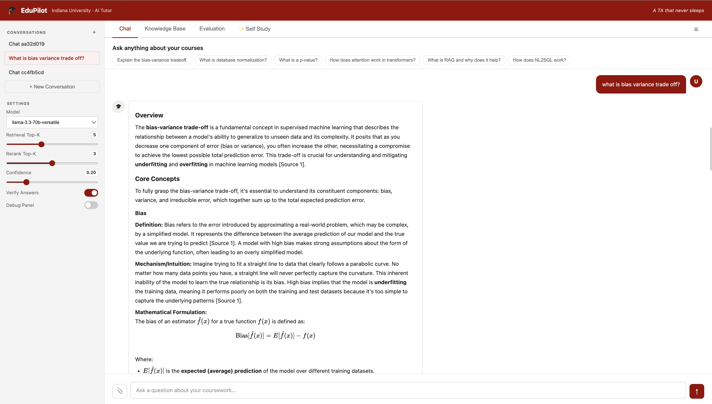
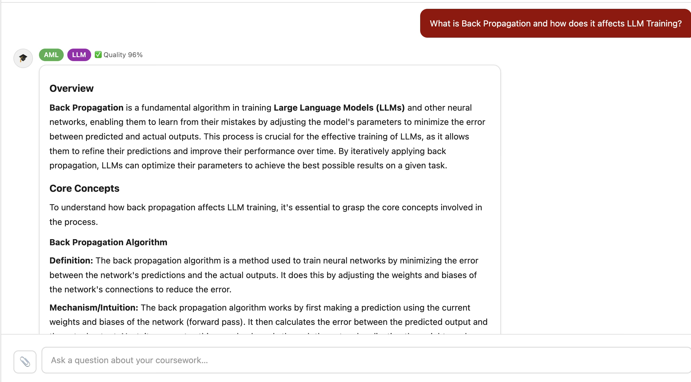
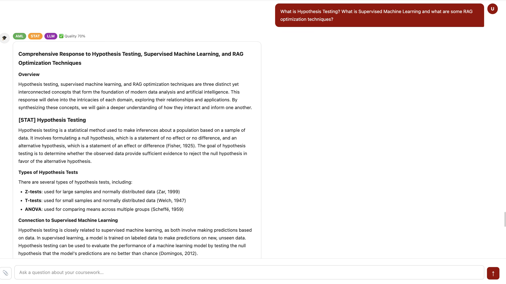
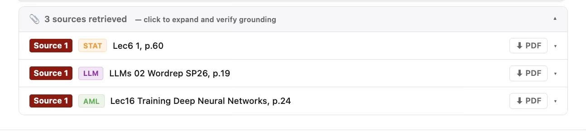
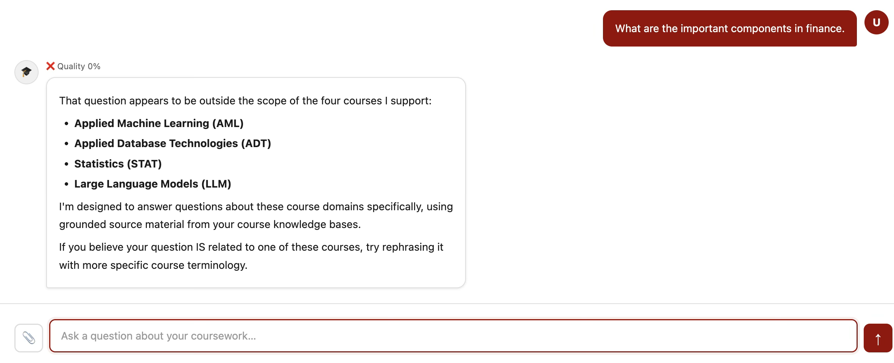
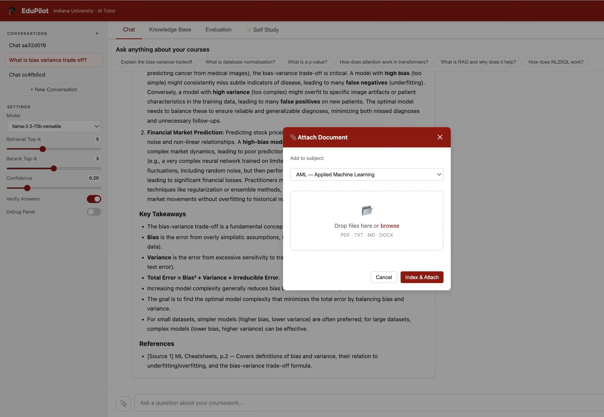
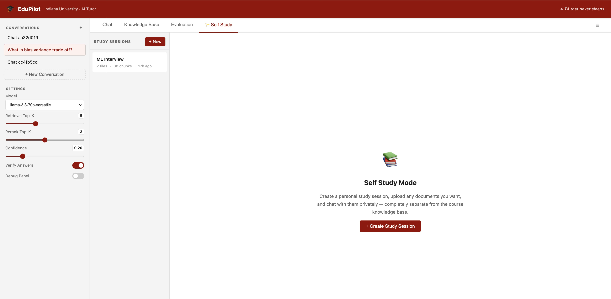
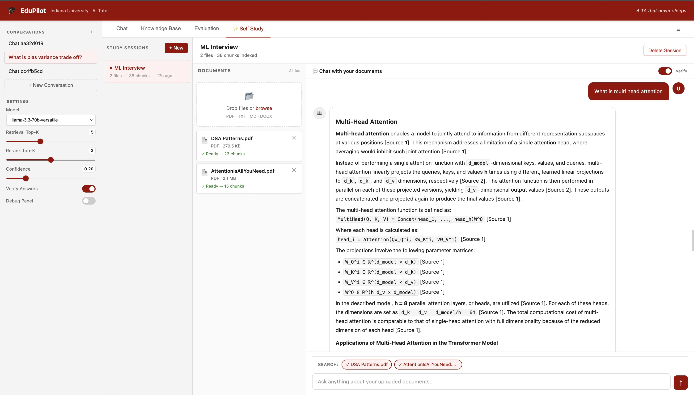
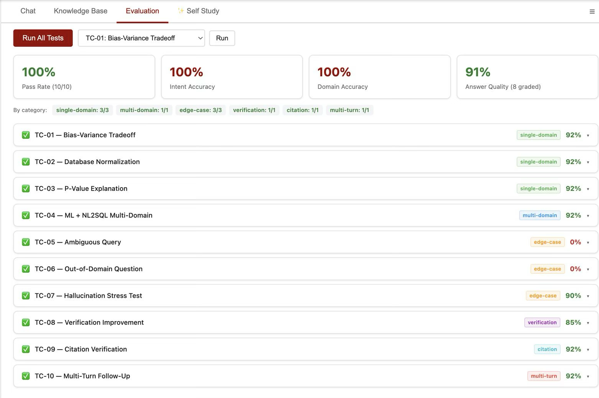

# EduPilot — AI Tutor for Indiana University

> **A Multi-Agent, Source-Grounded Educational AI System for Adaptive and Cross-Domain Learning**

EduPilot is an intelligent course assistant built for Indiana University students. It answers questions across three graduate courses — Applied Machine Learning (AML), Applied Algorithms (ALGO), and Large Language Models (LLM) — using an agentic RAG graph (LangGraph) that retrieves directly from course lecture slides and materials, corrects its own searches, cites every claim, verifies and revises its own answers, quizzes students on what they find hard, and refuses to hallucinate.

**Built by:** Akshar Patel · Khushi Shah  
**Institution:** Indiana University Bloomington

---

## Table of Contents

- [Overview](#overview)
- [Key Features](#key-features)
- [System Architecture](#system-architecture)
- [Screenshots](#screenshots)
- [Tech Stack](#tech-stack)
- [Project Structure](#project-structure)
- [Setup and Installation](#setup-and-installation)
- [Running the Application](#running-the-application)
- [Evaluation Suite](#evaluation-suite)
- [Configuration](#configuration)
- [API Reference](#api-reference)
- [Authors](#authors)

---

## Overview

EduPilot solves a core problem in educational AI: **LLMs hallucinate**. Generic chatbots answer confidently with no connection to actual course materials, making them unreliable for exam prep or homework help.

EduPilot's approach:

1. **Every answer is grounded** in the course knowledge base — retrieved chunks from real lecture slides, not GPT's parametric memory.
2. **Every claim is cited** with a `[Source N]` marker linking back to the exact lecture and page number.
3. **Every answer is verified** — the verifier scores grounding and coverage; below grounding 0.85 or coverage 0.60, a reviser repairs the claims it flagged, the revision is re-verified, and the better-scoring draft is kept.
4. **Cross-domain queries** are decomposed into sub-questions, answered independently per domain, and synthesized into a unified response.
5. **Out-of-domain questions** are politely refused rather than answered with hallucinated content.

---

## Key Features

| Feature | Description |
|---|---|
| **Agentic graph (LangGraph)** | Router → Planner → parallel per-domain research subgraphs → Synthesizer → Verifier ⇄ Reviser, with conditional edges, loops and a pause for clarification |
| **Corrective retrieval** | Each domain's excerpts are graded by an LLM; when none address the question, the search is rephrased in the course's terminology and retried before refusing |
| **Hybrid retrieval** | pgvector HNSW search and BM25 over an inverted index, fused with Reciprocal Rank Fusion (and optionally HyDE / multi-query probes), all inside Postgres |
| **Source citations** | Every answer includes `[Source N]` markers with lecture name and page number |
| **Verify → revise loop** | The verifier's unsupported and miscited claims go back to a reviser; the revision is re-verified and the better-scoring draft is kept |
| **Clarifying questions** | An unanswerable message ("explain this") pauses the turn with `interrupt()`; the student's next message resumes it |
| **Tutor tools** | "Quiz me on X" and "flashcards on Y" produce cited practice items — an interactive quiz that marks each answer and keeps score, and flip-through flashcards; a restricted calculator handles statistics on the student's numbers, and its results are cited like excerpts |
| **Adaptive learning profile** | Per-student topics, confusion signals and depth preference (LangGraph store) shape explanations and pick "quiz me" topics; shown and clearable on the **My Progress** page |
| **Cross-domain synthesis** | Automatically detects multi-domain queries and retrieves from each domain separately |
| **Out-of-domain guard** | Hard refusal for questions outside AML, ALGO and LLM scope |
| **Self Study Mode** | Upload any personal documents (PDF, TXT, DOCX) and chat with them privately |
| **Evaluation suite** | 50 test cases and 8 objective metrics — run the suite with `edupilot-evaluate` (a developer tool, not part of the student UI), or each configuration as a **LangSmith experiment** to compare them side by side |
| **Tracing + feedback** | Optional LangSmith tracing of every graph step, model call and tool call; students' 👍/👎 attach to the trace of the answer they rated |
| **Local or hosted models** | Embeddings and reranking run in-process (bge) or on Pinecone Inference, which drops PyTorch and the 1.2 GB of weights from the image |
| **Blue/green indexing** | Rebuilds write to a new index version and promote only on success — a failed rebuild changes nothing |
| **Auth + guardrails** | JWT auth with per-user ownership, rate limiting, upload validation, and prompt-injection scanning |
| **Answer cache** | Questions asked 3+ times are cached by semantic match, scoped to the index version and swept on rebuild |
| **Conversation memory** | LangGraph checkpointer per session: recent turns verbatim, older ones folded into a rolling digest |
| **Streaming** | Server-sent events with live stage progress ("Rephrasing the ALGO search…") and answer tokens |
| **Model selector** | Switch between Groq (Llama 3.3 70B, Llama 3.1 8B) and Gemini fallback at runtime |
| **Clickable citations** | Each `[Source N]` is a chip that opens the excerpt behind it, with the source PDF a click away |
| **Debug panel** | Routing, retrieval grades and rewrites, verification scores, token cost and a link to the LangSmith trace, per answer |

---

## System Architecture

Every message runs through a LangGraph `StateGraph` (`src/edupilot/agents/graph.py`):

```
Student message
     │
     ▼
 memory ──── load the session's checkpointed turns + rolling digest,
     │       and the student's learning profile
     ▼
 route ───── intent, domains, task (answer / quiz / flashcards), topics
     │
     ├── out of scope ─────────────────────────────────────────► finalize
     ├── unclear ──► clarify ── interrupt(): the turn pauses until the
     │                  │       student replies, then routing runs again
     ▼                  ▼
 plan ────── split into per-domain sub-questions
     │
     ▼  Send() — one branch per domain, in parallel
 ┌──────────────────── research subgraph ─────────────────────┐
 │ retrieve ─► grade ──relevant──► answer ◄──► tools          │
 │    ▲          │                   │       (calculator)     │
 │    └─ rewrite ◄┘ nothing relevant  └──► done               │
 └────────────────────────────────────────────────────────────┘
     │
     ▼
 collect ─── order branches, number citations globally
     │
     ├── question ──► synthesize ──► verify ◄──► revise
     │                                  │
     ├── quiz / flashcards ──► tutor ───┤
     ▼                                  ▼
                 guardrails ─── citation repair, claim-level grounding
                     │
                 learn ──────── update the student's profile
                     │
                 finalize ───── result + checkpoint the exchange
```

- **Hybrid retrieval** inside each branch: pgvector dense + BM25 sparse, RRF across both and across probes, `bge-reranker-base` with a calibrated floor, small-to-big parent expansion.
- **Corrective retrieval**: the grader keeps only excerpts that address the question; when none do, the rewriter rephrases the search in course terminology and the branch searches again before refusing.
- **Verify → revise**: below grounding 0.85 or coverage 0.60, the verifier's findings go to the reviser; the revision is re-verified and the better draft wins.
- **Tool loop**: the answerer may call `calculate`; each result becomes an extra numbered source.
- **Streaming**: `astream` over `updates`, `messages` and `custom` modes, including subgraph events, becomes server-sent events.

### Knowledge Domains

| Domain | Code | Colour | Coverage |
|---|---|---|---|
| Applied Machine Learning | **AML** | Green | Core ML algorithms, the Transformer and BERT papers |
| Applied Algorithms | **ALGO** | Blue | Asymptotic analysis, recurrences, sorting, divide and conquer, dynamic programming, greedy, data structures |
| Large Language Models | **LLM** | Purple | Transformers, attention, fine-tuning, RAG, prompt engineering |

The courses are defined once, in `DOMAINS` in `core/config.py`; the router and planner prompts, the refusal messages and the output schemas are all built from it.

---

## Screenshots

*These screenshots show the earlier vanilla-JS interface. The Next.js frontend keeps the same layout and features, and adds interactive quizzes, clickable citations, dark mode and the My Progress page.*

### Main Chat Interface

The full EduPilot UI — conversation history in the left sidebar, model and retrieval settings below it, suggested questions at the top, and the main answer pane. Domain tags (AML, ALGO, LLM) badge every response.



---

### High-Quality Single-Domain Answer (96% Quality)

EduPilot answers a cross-domain question about Backpropagation and LLM Training with a 96% quality score. The response is structured into Overview, Core Concepts, Algorithm definition, and Mechanism sections — all grounded in retrieved course material.



---

### Multi-Domain Answer (AML + STAT + LLM)

A query spanning three domains ("Hypothesis Testing, Supervised ML, and RAG optimisation techniques") is automatically decomposed. Each part is retrieved independently, then synthesized into one unified answer. Domain badges show which knowledge base each section came from.



---

### Source Citations Panel

Every answer includes an expandable citations panel showing exactly which lecture slide and page each source came from. Sources span multiple domains (STAT, LLM, AML) in a single response and are downloadable as PDFs.



---

### Out-of-Domain Rejection

When a question falls outside the four supported courses (e.g., "What are the important components in finance?"), EduPilot refuses to answer rather than hallucinate, and clearly lists the four supported domains.



---

### Document Upload to Knowledge Base

Instructors or students can extend any domain knowledge base by attaching PDF, TXT, or DOCX files through the drag-and-drop upload modal. Files are indexed into the vector store, with their BM25 term weights, automatically.



---

### Self Study Mode

Self Study Mode lets students upload any personal documents — notes, textbooks, past papers — and chat with them privately. This is completely separate from the course knowledge base and does not affect other users.



---

### Self Study Session — Active Chat

An active "ML Interview" study session with two uploaded PDFs (38 chunks). EduPilot answers a question about Multi-Head Attention with inline `[Source N]` citations drawn exclusively from the uploaded documents.



---

### Evaluation Dashboard

The evaluation dashboard from the original Streamlit UI, showing results across the 10-case suite — 100% intent accuracy, 100% domain accuracy, retrieval hit rate 0.49, mean quality 0.84, and citation accuracy 1.00 with the primary model (Llama-3.3-70B).

*This screenshot is historical.* The Streamlit UI has been retired in favour of the bundled single-page frontend, and the suite now runs from the command line with `edupilot-evaluate`, which prints the same scorecard.



---

## Tech Stack

| Layer | Technology |
|---|---|
| **Agent orchestration** | **LangGraph** `StateGraph`: typed state with reducers, parallel per-domain fan-out with `Send`, conditional edges, run context via `Runtime` |
| **Conversation memory** | LangGraph **Postgres checkpointer** keyed by `thread_id = session_id`, with a rolling-summary node and `RemoveMessage` folding; student profiles in the LangGraph **Postgres store** |
| **LLM layer** | **LangChain** chat models — `ChatGroq` (Llama 3.3 70B, Llama 3.1 8B) · `ChatGoogleGenerativeAI` (Gemini 2.0/2.5 Flash) — with `with_fallbacks`, `ChatPromptTemplate`, and Pydantic `with_structured_output` |
| **Streaming** | Server-sent events from `graph.astream` (`updates` + `messages` + `custom` modes): stage progress and answer tokens |
| **Embeddings** | `BAAI/bge-small-en-v1.5` in-process (384-dim, 512-token window, asymmetric query prefix), or `llama-text-embed-v2` on Pinecone Inference |
| **Vector Store** | **pgvector** in Postgres: HNSW over inner product with filtered (iterative) scans, one table per blue/green index version. Pinecone Serverless remains as an optional backend |
| **Keyword Search** | BM25 term weights computed at ingest, stored as `sparsevec` with a GIN inverted index on the terms (no in-memory index) |
| **Fusion** | Reciprocal Rank Fusion of dense and lexical lists, and across HyDE / multi-query probes |
| **Reranking** | `BAAI/bge-reranker-base` cross-encoder, or `bge-reranker-v2-m3` on Pinecone Inference, with a per-model relevance floor |
| **Tracing + evaluation** | **LangSmith**: traces with per-turn run ids and metadata, feedback, datasets and experiments |
| **Backend** | FastAPI + Uvicorn, async end to end (model calls awaited; vector search, reranking and grounding checks on worker threads) |
| **Frontend** | **Next.js 16** (App Router) · React 19 · TypeScript · Tailwind CSS 4 · **shadcn/ui** (Radix) · react-markdown with KaTeX and highlight.js · Vitest. Built as a static export and served by FastAPI, so there is no Node server in production |
| **Database** | **PostgreSQL 17** with pgvector, one database for everything: **SQLAlchemy 2** Core over psycopg 3, **Alembic** migrations run at startup under an advisory lock, embedding and answer caches |
| **Document Parsing** | PyMuPDF + pdfplumber (PDF, tables) · python-docx (DOCX) · Tesseract (OCR fallback) · optional **Docling** layout models for re-indexing the course corpus |
| **Scale-out** | Stateless API replicas behind **nginx**; **Redis** for shared rate limits and a global turn limit; admission control (503 + `Retry-After` past capacity); a CPU inference gate for the cross-encoder; uploads indexed by an **`edupilot-worker`** from a Postgres job queue (`FOR UPDATE SKIP LOCKED`) |
| **Observability** | **Prometheus** metrics at `/metrics` (latency histograms, time to first token, turns running and waiting, model calls, cache hit rate, queue depth, DB pool) and a provisioned **Grafana** dashboard |
| **Load testing** | **Locust** with a simulated-model mode, so a run measures the system rather than a provider's rate limit — see [docs/load-testing.md](docs/load-testing.md) |
| **Auth** | JWT access tokens + rotating refresh tokens, bcrypt password hashing |
| **Tooling** | Python 3.12 · **uv** with a lockfile (`uv.lock`) · ruff · pytest |

---

## Project Structure

A `src/` layout: importable code lives in `src/edupilot`, everything the
application reads or writes at runtime lives in `data/`. Only `data/` needs to
be writable, and it is the only path worth mounting in a container.

```
EduPilot/
├── pyproject.toml               # packaging, dependencies and extras, uv + ruff + pytest config
├── uv.lock                      # exact versions every install and the image use
├── .env.example                 # documented environment template
│
├── src/edupilot/
│   ├── api/                     # HTTP layer — routing and nothing else
│   │   ├── app.py               #   application factory, middleware, error handlers
│   │   ├── deps.py              #   auth annotations, worker pool, validators
│   │   ├── schemas.py           #   pydantic request bodies
│   │   ├── sse.py               #   server-sent-event framing for streaming routes
│   │   └── routes/              #   one module per resource
│   │       ├── auth.py          #     register / login / refresh / logout / me
│   │       ├── chat.py          #     course chat: JSON and server-sent-event stream
│   │       ├── sessions.py      #     conversation history
│   │       ├── knowledge_base.py#     shared corpus (admin-gated writes)
│   │       ├── self_study.py    #     private per-student documents + chat
│   │       ├── profile.py       #     read / clear the caller's learning profile
│   │       ├── feedback.py      #     👍/👎 on answers, LangSmith trace links
│   │       ├── evaluation.py    #     test-case listing
│   │       └── system.py        #     SPA entry, health, client config
│   │
│   ├── agents/                  # the agentic graph (see System Architecture)
│   │   ├── graph.py             #   parent StateGraph: routing, clarify, revise loop, tutor, run/stream
│   │   ├── research.py          #   per-domain subgraph: retrieve, grade, rewrite, answer, tools
│   │   ├── state.py             #   graph state schemas and reducers
│   │   ├── context.py           #   PipelineConfig, the per-request run context
│   │   ├── nodes.py             #   the agents: router, planner, grader, rewriter, answerer,
│   │   │                        #   synthesizer, verifier, reviser, tutor
│   │   ├── tools.py             #   the restricted calculator tool
│   │   ├── profile.py           #   per-student learning profiles in the LangGraph store
│   │   ├── memory.py            #   rolling summary, seeding threads from the database
│   │   ├── checkpoint.py        #   Postgres checkpointer + store on one async pool
│   │   ├── contracts.py         #   evidence fencing, structured-output schemas
│   │   └── prompts.py           #   every prompt, as ChatPromptTemplates
│   │
│   ├── retrieval/               # embeddings, vector store, hybrid search, reranking
│   │   ├── embeddings.py        #   local and Pinecone-hosted embedders + embedding cache
│   │   ├── pgvector.py          #   the pgvector store: HNSW, BM25 inverted index, RRF
│   │   ├── vectorstore.py       #   the store interface; Pinecone and in-memory backends
│   │   ├── versions.py          #   index versions and the live pointer (blue/green)
│   │   ├── sparse.py            #   BM25 term weights for sparse vectors
│   │   ├── hybrid.py            #   RRF fusion across probes
│   │   ├── query_transform.py   #   acronym expansion, multi-query, HyDE
│   │   ├── rerank.py            #   local or hosted reranker + calibrated floors
│   │   ├── indexer.py           #   ingest orchestration, blue/green rebuilds
│   │   └── lc_retriever.py      #   the hybrid retriever as a LangChain BaseRetriever
│   │
│   ├── ingestion/               # document → blocks → sections → chunks
│   │   ├── pdf.py               #   PyMuPDF + pdfplumber + OCR fallback
│   │   ├── docling_parser.py    #   optional layout-model PDF parser (Docling)
│   │   ├── office.py            #   DOCX and Markdown
│   │   ├── normalize.py         #   header/footer stripping, unicode cleanup
│   │   ├── chunking.py          #   token-aware, section-respecting chunker
│   │   ├── jobs.py              #   the upload queue and its worker loop
│   │   └── models.py            #   Block / Section / ParsedDocument
│   │
│   ├── guardrails/              # citation, grounding, injection, output checks
│   ├── security/                # auth, rate limiting, uploads, error envelopes
│   ├── evaluation/              # cases.py (50 cases) · metrics.py · runner.py · experiments.py (LangSmith)
│   ├── llm/                     # LangChain chat models, fallback chain, token-usage callback
│   ├── db/                      # Postgres: engine · tables · migrations (Alembic) · chat · self_study · feedback
│   ├── core/                    # config · services · observability · tracing · metrics · admission · redis
│   ├── cli/                     # edupilot-reindex, edupilot-evaluate, edupilot-db, edupilot-worker
│   └── web/static/              # built frontend (generated by `npm run build`; ships with the package)
│
├── frontend/                    # Next.js app (static export)
│   ├── src/app/                 #   routes: / (chat), study/, knowledge/, evaluation/, profile/
│   ├── src/components/          #   chat, self study, answer (sources, feedback, debug), practice (quiz,
│   │                            #   flashcards), shadcn/ui primitives
│   ├── src/lib/                 #   API client + SSE parser, types, progress labels, markdown prep
│   └── scripts/copy-export.mjs  #   copies the export into src/edupilot/web/static
│
├── tests/                       # pytest suite (pinned to a throwaway DATA_DIR and Postgres database)
├── docs/screenshots/            # UI screenshots used in this README
│
├── docker-compose.yml           # Postgres + pgvector, Redis, API replicas, nginx, worker, Prometheus, Grafana
├── loadtest/locustfile.py       # simulated students for load tests
├── docs/load-testing.md         # load test method, results and findings
│
└── data/                        # gitignored — the course corpus; everything else is in Postgres
    └── knowledge_base/          #   aml/ applied_algorithms/ llm/
```

---

## Setup and Installation

### Prerequisites

- [uv](https://docs.astral.sh/uv/) (`brew install uv`, or `curl -LsSf https://astral.sh/uv/install.sh | sh`), which installs Python 3.12 for you if needed
- [Docker](https://docs.docker.com/get-docker/), for Postgres with pgvector (or any Postgres 15+ with pgvector 0.8+)
- A [Groq](https://console.groq.com) API key (free tier available)
- (Optional) A [Google Gemini](https://aistudio.google.com) API key for fallback
- [Node.js](https://nodejs.org) 20.9 or newer, to build the frontend
- (Optional) Tesseract OCR, for scanned PDF pages without a text layer:
  `brew install tesseract` / `apt-get install tesseract-ocr`

### 1. Clone the repository

```bash
git clone https://github.com/Akshar106/EduPilot-A-Multi-Agent-Source-Grounded-Educational-AI-System-for-Adaptive-and-Cross-Domain-Learning.git
cd EduPilot-A-Multi-Agent-Source-Grounded-Educational-AI-System-for-Adaptive-and-Cross-Domain-Learning
```

### 2. Install the project

Creates `.venv` and installs `edupilot` in editable mode with the exact versions in `uv.lock`, plus the dev tools:

```bash
uv sync --extra local-models
```

`local-models` adds PyTorch and sentence-transformers for the default in-process embedding and reranking models. Leave it out when using hosted models (see [Hosted embeddings and reranking](#hosted-embeddings-and-reranking)); add `--extra docling` for the layout-model PDF parser. Run commands inside the environment with `uv run`, e.g. `uv run pytest`, or activate it with `source .venv/bin/activate`.

Without uv, `pip install -e ".[local-models]"` still works, just without the lockfile.

Then build the frontend once; the build is copied into the Python package, where FastAPI serves it:

```bash
cd frontend && npm ci && npm run build && cd ..
```


### 3. Configure environment variables

Copy the documented template and fill it in — every variable is explained inline:

```bash
cp .env.example .env
```

At minimum set `GROQ_API_KEY` and `JWT_SECRET_KEY`. Generate the signing key with:

```bash
python3 -c "import secrets; print(secrets.token_urlsafe(48))"
```

Set `BOOTSTRAP_ADMIN_EMAIL` and `BOOTSTRAP_ADMIN_PASSWORD` too — the first admin is created on startup when no users exist, and without one the knowledge-base routes are unreachable.

### 4. Start Postgres

```bash
docker compose up -d db
```

This runs Postgres 17 with pgvector on `localhost:5434` (not 5432, so it does not collide with a Postgres you already run), which is what the default `DATABASE_URL` points at. The app creates and migrates its tables on startup; `edupilot-db upgrade` does the same by hand, and `edupilot-db revision -m "..."` writes a new migration after a change to `db/tables.py`.

### 5. Add course materials to the knowledge base

Place PDF, TXT, MD, or DOCX files into the appropriate subdirectory (folder names are matched ignoring case, spaces and underscores, so `AML/` and `Applied Algorithms/` work too):

```
data/knowledge_base/aml/                  ← AML materials
data/knowledge_base/applied_algorithms/   ← Applied Algorithms lecture slides
data/knowledge_base/llm/                  ← LLM course materials
data/knowledge_base/llm/book/             ← a textbook for the course
```

Subfolders are read too. Put a course's **textbook in a `book/` subfolder**: it is then indexed as a book, cited as one ("… (book), p.312"), and used to support the lectures rather than replace them.

A textbook covers every topic at length and outnumbers the lecture chunks — the Applied Algorithms book is 2,076 chunks against 86 from ten lecture decks — so ranked on relevance alone it wins nearly every question. Retrieval therefore treats the two differently: each search looks at course material and books separately (books get a quarter of the candidates), at most `MAX_BOOK_EXCERPTS` (default 2) of the excerpts an answer is written from come from a book while the lectures can supply the rest, and the lectures are listed first. Where the lectures have nothing relevant, the book fills in. Measured on the evaluation questions:

| Course | Book as the first source | Book share of excerpts | Keyword recall |
|---|---|---|---|
| Applied Algorithms | 9/13 → 0/13 | 77% → 41% | 1.00 → 1.00 |
| AML | 12/15 → 1/15 | 82% → 39% | 0.84 → 0.82 |
| LLM | 8/16 → 0/16 | 37% → 23% | 0.80 → 0.80 |

### 6. Build the index

```bash
edupilot-reindex --rebuild
```

This extracts, chunks, embeds, and upserts every document into a **new** index version (a new pgvector table), promoting it only after every course succeeds. The live index keeps serving throughout, so a failed rebuild changes nothing, and running API processes switch to the new version within a few seconds. Students' Self Study uploads are copied into the new version. Check the result with `edupilot-reindex --status`; `--rollback` reverts and `--drop <version>` frees a retired one.

To parse PDFs with Docling's layout models instead of the rule-based extractor (better reading order, headings and tables on slides and two-column papers; roughly a second per page on CPU):

```bash
uv sync --extra local-models --extra docling
edupilot-reindex --rebuild --dry-run --parser docling   # compare chunks, pages and tables first
edupilot-reindex --rebuild --parser docling
```

OCR is off for Docling by default (`DOCLING_OCR=true` turns it on); the dry run reports pages that came out empty. Student uploads always use the fast parser, since a student is waiting on them.

Admins can also add documents at runtime via `POST /api/kb/upload`, which indexes incrementally.

---

## Running the Application

```bash
uv run uvicorn edupilot.api.app:app --host 0.0.0.0 --port 8000 --reload --reload-dir src
```

- App: `http://localhost:8000`
- Interactive docs: `http://localhost:8000/docs` (disabled when `EDUPILOT_ENV=production`)

`--reload-dir src` keeps the reloader to the Python code: without it, it also watches `frontend/node_modules`, and every `npm install` restarts the server.

FastAPI serves the built frontend from the same process, so in production there is no separate UI server. (Without a build, `GET /` says how to make one.)

### The full stack: replicas, Redis, worker, metrics

```bash
docker compose up -d --build                     # nginx :8088 -> 2 API replicas, worker, Redis, Postgres
docker compose --profile metrics up -d           # plus Prometheus :9095 and Grafana :3001
```

Every API replica is interchangeable: conversations, checkpoints, the index and its live version are in Postgres, and rate limits and the global turn limit are in Redis, so `API_REPLICAS=4 docker compose up -d` is the whole scaling procedure. Uploads return `202` at once; the worker indexes them and `GET /api/jobs/{id}` reports progress.

How many questions run at once is bounded, so a burst sheds load instead of slowing everyone down. A turn waits up to `ADMISSION_TIMEOUT_SECONDS` for a slot, then gets `503` with `Retry-After`. The defaults (`MAX_CONCURRENT_TURNS`, `GLOBAL_MAX_TURNS`, `INFERENCE_THREADS`) come from the load tests in [docs/load-testing.md](docs/load-testing.md), which also show what each one buys.

To load test, run the stack with simulated models and point Locust at it:

```bash
LLM_SIMULATED=true docker compose up -d
uv run --group load locust -f loadtest/locustfile.py --host http://localhost:8088
```

### Frontend development

For live reloading while changing the UI, run the API as above and the Next.js dev server next to it. It proxies `/api` to port 8000 (`EDUPILOT_API` overrides that), so the browser sees a single origin:

```bash
cd frontend && npm run dev
```

Then open `http://localhost:3000`. `npm run lint`, `npm run typecheck` and `npm test` are what CI runs.

### Single-user mode

By default in development, `EDUPILOT_AUTH_REQUIRED=false`: there is no sign-in, and every request resolves to one fixed local identity (`local-single-user`) with admin rights. That is what lets the bundled frontend work without a login screen. Access control is not removed — sessions and uploads still carry an owner, and every ownership check still runs; there is simply one owner.

Production always requires authentication. Setting `EDUPILOT_AUTH_REQUIRED=false` with `EDUPILOT_ENV=production` is **refused at startup**, because an open knowledge base lets any visitor inject documents that every student's answers are then grounded in.

To require sign-in locally, set `EDUPILOT_AUTH_REQUIRED=true` and register through `POST /api/auth/register`. Note the bundled frontend has no login UI, so it will need one before that mode is usable in a browser.

### Troubleshooting

**`ModuleNotFoundError: No module named 'edupilot'`** — the editable install's `.pth` file is not being honoured. On macOS this happens when the repo lives in an iCloud-synced folder (`~/Documents` with Desktop & Documents sync on): iCloud sets the `hidden` flag on files inside `.venv`, and Python 3.14 skips hidden `.pth` files. Work around it with an explicit path, or move the repo outside the synced folder:

```bash
PYTHONPATH="$PWD/src" uvicorn edupilot.api.app:app --reload --reload-dir src --port 8000
```

**`bad interpreter` when running `.venv/bin/uvicorn`** — the script's shebang is baked in at install time and breaks if the project moves, or if the absolute path exceeds the kernel's ~127-character shebang limit. Invoke the module instead, which has no shebang:

```bash
./.venv/bin/python -m uvicorn edupilot.api.app:app --reload --reload-dir src --port 8000
```

**`connection refused` on port 5434 at startup** — Postgres is not running. `docker compose up -d db`, or point `DATABASE_URL` at your own server.

**`extension "vector" is not available`** — the server has no pgvector. Use the `pgvector/pgvector:pg17` image, or install the extension (managed providers list it as "vector" or "pgvector").

**Running the tests** — `uv run pytest` starts a throwaway pgvector container through Docker for the run. Without Docker, set `EDUPILOT_TEST_DATABASE_URL` to a Postgres server the run may create (and then drop) a database on.

---

## Evaluation Suite

EduPilot ships with a **50-case evaluation suite** covering all pipeline layers across four categories:

| Category | Cases | Description |
|---|---|---|
| Single-domain | 25 | Factual and conceptual queries spanning the AML, ALGO and LLM domains |
| Multi-domain | 10 | Cross-domain queries requiring multi-namespace synthesis |
| Edge-case | 8 | Out-of-domain, ambiguous, and empty-retrieval cases that should refuse |
| Adversarial | 7 | Fabricated concepts and false-premise queries stressing hallucination resistance |
| **Total** | **50** | |

### Reported results — 10-case suite, Llama-3.3-70B

> These figures come from the original 10-case suite used in the project report. The suite has since grown to 50 cases, so they are kept for reference rather than as current numbers. Re-run `edupilot-evaluate` to measure the present system.

| Category | N | Intent | Hit Rate | Quality |
|---|---|---|---|---|
| Single-domain | 6 | 1.00 | 0.53 | 0.91 |
| Multi-domain | 2 | 1.00 | 0.50 | 0.70 |
| Adversarial | 2 | 1.00 | 0.20 | 0.70 |
| **Overall** | **10** | **1.00** | **0.49** | **0.84** |

Citation accuracy: **1.00** across all generating queries. No verifier revisions triggered.

### Eight metrics measured per query

| Metric | What it measures |
|---|---|
| Intent Match | Router correctly classified single vs. multi intent |
| Domain Match | Router routed to the correct domain(s) |
| Retrieval Hit Rate | Fraction of expected keywords found in retrieved chunks |
| Faithfulness | LLM-judged grounding of answer in retrieved evidence |
| Citation Accuracy | `[Source N]` markers match their referenced chunks |
| Quality Score | Verifier rubric score (0.95–1.00 Exceptional, 0.70–0.84 Adequate) |
| Coverage Score | Sub-topics addressed relative to expected behavior |
| Latency (ms) | End-to-end wall-clock time |

### Model comparison (10 queries, 3 providers)

| Metric | Llama-3.3-70B | Llama-3.1-8B | Gemini-2.5-Flash |
|---|---|---|---|
| Quality score | **0.842** | 0.830 | 0.847 |
| Citation accuracy | **1.000** | 0.270 | **1.000** |
| Faithfulness | 0.662 | **0.725** | 0.450 |
| Avg latency (ms) | **13,785** | 15,073 | 15,117 |

Key finding: a **3.7× citation-accuracy gap** between Llama-70B and Llama-8B on identical inputs — purely from model choice.

### Running the evaluation

```bash
edupilot-evaluate
```

Useful flags:

```bash
edupilot-evaluate --category edge-case              # one category
edupilot-evaluate --case TC-01 --case TC-04         # specific cases
edupilot-evaluate --model openai/gpt-oss-20b         # compare a model
edupilot-evaluate --json results.json               # machine-readable output
```

A scorecard prints to stdout; `--json` additionally writes per-case results. The command exits non-zero when any case fails, so it works as a CI gate. Reproduce the model comparison above by running it once per model with `--model` and `--json`.

A full pass is hundreds of LLM calls, which is why it is a CLI rather than an API route — `GET /api/evaluate/cases` only *lists* the suite.

### As LangSmith experiments

With `LANGSMITH_API_KEY` set, the suite runs as LangSmith experiments: the 50 cases are kept as a dataset (created on first run, updated in place after), and each configuration variant is one experiment on it, scored by the same rules as the local run. LangSmith then shows variants side by side per case and per metric, with latency, token counts and the full trace behind every answer.

```bash
edupilot-evaluate --langsmith                                   # the default configuration
edupilot-evaluate --langsmith --variant baseline --variant lean # with and without the agentic extras
```

| Variant | What changes |
|---|---|
| `baseline` | nothing — the configured defaults |
| `no-corrective` | no excerpt grading or query rewriting |
| `no-revision` | no verify → revise loop |
| `no-tools` | no calculator tool |
| `lean` | all three off |

This is how to decide whether a feature earns its extra model calls, and how to compare local and hosted retrieval: run the suite, switch `EMBEDDING_MODEL` / `RERANKER_MODEL`, rebuild, run it again.

---

## Configuration

Tunable parameters live in `src/edupilot/core/config.py`. Anything read from the environment is documented in `.env.example`.

```python
# Retrieval
DEFAULT_TOP_K = 8                   # candidates retrieved before reranking
DEFAULT_RERANK_TOP_K = 5            # chunks passed to the LLM after reranking

# Chunking — measured in embedding-model TOKENS, not words
CHUNK_MAX_TOKENS = 448              # hard ceiling, under the 512-token window
CHUNK_TARGET_TOKENS = 320           # preferred size
CHUNK_MIN_TOKENS = 64               # below this, merge into a neighbour
PARENT_MAX_TOKENS = 1400            # wider window for small-to-big retrieval

# Query transformation — each LLM-backed step costs a round-trip, so both
# default off. Acronym expansion is deterministic and always on.
ENABLE_MULTI_QUERY = False
ENABLE_HYDE = False
ENABLE_PARENT_EXPANSION = True

# Agentic behaviour — each trades latency and tokens for quality (env-overridable)
CORRECTIVE_RETRIEVAL = True         # grade excerpts; rephrase and retry before refusing
MAX_QUERY_REWRITES = 1              # retries per domain
MAX_REVISIONS = 1                   # verify -> revise rounds; 0 disables revision
ENABLE_TUTOR_TOOLS = True           # the calculator tool
DEFAULT_QUIZ_SIZE = 5               # practice items when the student gives no number

# Models
DEFAULT_MODEL   = "openai/gpt-oss-120b"       # Groq
VERIFY_MODEL    = "openai/gpt-oss-120b"
EMBEDDING_MODEL = "BAAI/bge-small-en-v1.5"    # or "llama-text-embed-v2" (hosted)
RERANKER_MODEL  = "BAAI/bge-reranker-base"    # or "bge-reranker-v2-m3" (hosted)
```

Two knobs deliberately live next to the code that applies them rather than here:

- **RRF weights** — `PROBE_WEIGHTS` and `RRF_K` in `retrieval/hybrid.py`. Fusion weights each *probe* (dense, sparse, HyDE, multi-query), not two fixed modalities, so a pair of scalars could not express it.
- **Minimum relevance** — calibrated per reranker in `retrieval/rerank.py`, because the score scale is model-specific. Set `DEFAULT_MIN_RELEVANCE` to override.

### Hosted embeddings and reranking

Embedding and reranking can run on Pinecone Inference instead of in-process, with a `PINECONE_API_KEY` (the vectors themselves stay in pgvector). The web image then needs no PyTorch and no model weights, so it is smaller and boots without first loading 1.2 GB of models.

1. Measure the current setup: `edupilot-evaluate --langsmith --variant baseline`.
2. Set `EMBEDDING_MODEL=llama-text-embed-v2` and `RERANKER_MODEL=bge-reranker-v2-m3`.
3. Rebuild: `edupilot-reindex --rebuild`. The new model's vectors are 1024-dimensional, so they go into a new index version; the app refuses to query an index built with a different model and names the fix.
4. Measure again. If it is worse, `edupilot-reindex --rollback` and switch the variables back.
5. Build the image without local models: `docker build --build-arg LOCAL_MODELS=false .`. The live index version is in the database, so the deployment needs no other change.

Two things change with hosted models. Each query makes a network call to the embedding and reranking models (recent query vectors are reused within a turn). And the claim-level grounding check, which needs a local cross-encoder, is skipped and reported as not measured; the LLM verifier still audits every answer. Hosting that check would cost one rerank request per claim. The relevance floor for `bge-reranker-v2-m3` is carried over from `bge-reranker-base` and has not yet been calibrated on this corpus.

### Tracing with LangSmith

Set `LANGSMITH_TRACING=true` and `LANGSMITH_API_KEY` (optionally `LANGSMITH_PROJECT`, default `edupilot`). Each turn is one trace, `chat_turn` or `self_study_turn`, containing every graph node, model call, retrieval and tool call. Traces carry the model, the agentic switches and the embedding and reranking models as metadata, and a conversation's turns are grouped into one LangSmith thread. User ids are replaced by a pseudonym.

The debug panel links to each answer's trace (admins only), and students' 👍/👎 are attached to it as `student_rating` feedback. Ratings are also stored locally, so they are kept without LangSmith too. Traces include questions and course excerpts; `LANGSMITH_HIDE_INPUTS=true` and `LANGSMITH_HIDE_OUTPUTS=true` keep the run structure, timings and token counts without the text.

### Adding a course domain

Add one entry to `DOMAINS` in `config.py`, drop files into `data/knowledge_base/<dir>/`, and run `edupilot-reindex --rebuild`. No other code changes are needed — routing, retrieval, and the frontend all read the registry.

---

## API Reference

Every route is rate limited and returns a typed error envelope. All routes except `GET /`, `GET /api/health`, `GET /api/config`, and the auth entry points require a bearer token; knowledge-base writes require the `admin` role.

| Method | Path | Auth | Purpose |
|---|---|---|---|
| `POST` | `/api/auth/register` | — | Create an account |
| `POST` | `/api/auth/login` | — | Exchange credentials for tokens |
| `POST` | `/api/auth/refresh` | — | Rotate a refresh token |
| `POST` | `/api/auth/logout` | user | Revoke all refresh tokens |
| `GET` | `/api/auth/me` | user | Current identity |
| `GET` | `/api/health` | — | Dependency readiness |
| `GET` | `/api/config` | — | Models, domains, defaults for the frontend |
| `POST` | `/api/chat` | user | Full multi-agent graph, one JSON reply |
| `POST` | `/api/chat/stream` | user | The same turn as server-sent events: progress, tokens, then the reply |
| `GET`/`POST` | `/api/sessions` | user | List / create conversations |
| `GET`/`DELETE` | `/api/sessions/{id}` | owner | Read / delete one conversation |
| `DELETE` | `/api/sessions/{id}/messages/{mid}` | owner | Truncate from a message (edit-and-resend) |
| `GET` | `/api/kb/status` | user | Per-domain chunk counts and documents |
| `GET` | `/api/kb/documents` | user | Indexed documents by domain |
| `POST` | `/api/kb/upload` | **admin** | Add documents to the shared corpus |
| `DELETE` | `/api/kb/{domain}/{filename}` | **admin** | Remove a document and its vectors |
| `GET` | `/api/documents/{domain}/{filename}` | user | Serve a source PDF behind a citation |
| `GET`/`POST` | `/api/self-study/sessions` | user | List / create private study sessions |
| `GET`/`DELETE` | `/api/self-study/sessions/{id}` | owner | Read / delete a study session |
| `POST` | `/api/self-study/sessions/{id}/upload` | owner | Upload private documents |
| `DELETE` | `/api/self-study/sessions/{id}/documents/{doc_id}` | owner | Remove one private document |
| `POST` | `/api/self-study/chat` | owner | Chat over your own documents ("quiz me on my notes" works too) |
| `GET`/`DELETE` | `/api/profile` | user | Read / clear your learning profile |
| `POST` | `/api/feedback` | owner | Rate an answer 👍/👎 (`kind`, `message_id`, `rating`, optional `comment`) |
| `GET` | `/api/trace/{run_id}` | **admin** | Redirect to the answer's LangSmith trace (when tracing is on) |
| `GET` | `/api/evaluate/cases` | user | List the 50 test cases |

### `POST /api/chat`

**Request:**
```json
{
  "query": "What is the bias-variance tradeoff?",
  "session_id": "abc123",
  "model": "openai/gpt-oss-120b",
  "top_k": 8,
  "rerank_top_k": 5,
  "enable_verification": true,
  "task": null
}
```

`task` is optional: `"quiz"` or `"flashcards"` forces a tutor task; omitted, the router infers it ("quiz me on heapsort").

`session_id` is optional — omit it and a new session is created, owned by the caller. Ownership always comes from the bearer token, never from the body.

**Response:**
```json
{
  "session_id": "abc123",
  "final_answer": "The bias-variance tradeoff describes...",
  "intent_type": "single",
  "detected_domains": ["AML"],
  "is_course_related": true,
  "needs_clarification": false,
  "awaiting_clarification": false,
  "refused": false,
  "task": "answer",
  "grounding_score": 0.92,
  "guardrail_action": "pass",
  "verification_revised": false,
  "sources": [
    { "source_num": 1, "citation_label": "AML · Lec3 p.12", "text": "..." }
  ],
  "practice": null,
  "debug": { "retrieval": {}, "guardrails": {}, "usage": {} }
}
```

`practice` is set when the tutor wrote the answer: `{"type": "quiz", "title", "items": [{"question", "options", "answer_index", "explanation", "source"}]}` or `{"type": "flashcards", "title", "items": [{"front", "back", "source"}]}`, with `source` a `[Source N]` number or `null`. `final_answer` carries the same content as markdown, for clients without an interactive view. It is also stored with the message, so a reloaded conversation can show the quiz again.

`grounding_score` is `null` when grounding was not measured — it is never defaulted or floored, so a missing score is distinguishable from a low one.

`awaiting_clarification: true` means the turn is paused on the clarifying question in `final_answer`; the next message in the same session is taken as the reply and resumes it.

### `POST /api/chat/stream`

Same request body as `/api/chat`. The response is `text/event-stream`:

```
event: stage
data: {"stage": "route", "intent_type": "multi", "domains": ["AML", "ALGO"], "is_course_related": true}

event: progress
data: {"stage": "retrieving", "domain": "ALGO", "attempt": 1}

event: progress
data: {"stage": "rewriting", "domain": "ALGO", "query": "running time of merge sort recurrence"}

event: token
data: {"text": "The bias-variance "}

event: result
data: { ...exactly the /api/chat response body... }
```

`result` (or `error`, carrying the usual error envelope) is always the last event. A `reset` event means the tokens streamed so far are being replaced — a revision after a failed verification, or the answer after a calculation. Tokens are streamed only from the model call that writes the answer the student reads — the domain answer for a single-domain question, the synthesizer's merge for a split one. The final `result` carries the guardrail-checked text, which can differ from the streamed draft when citations were repaired.

---

## Authors

| Name | Email | Contributions |
|---|---|---|
| **Akshar Patel** | akspate@iu.edu | System architecture, hybrid retrieval pipeline (Pinecone + BM25 + RRF), query router with keyword fallback, query splitter, SQLite database layer, FastAPI async backend, confidence-thresholded reranker, evaluation suite construction, report writing |
| **Khushi Shah** | khusshah@iu.edu | Domain agent prompt engineering, cross-domain synthesizer, two-pass verifier with targeted revision, Self Study module, Streamlit debug UI, all seven prompt templates, evaluation framework (10 queries, 8 metrics, three categories), 3-model comparison analysis, primary report writing |

Indiana University Bloomington · Luddy School of Informatics, Computing, and Engineering

---

*EduPilot — A TA that never sleeps.*
